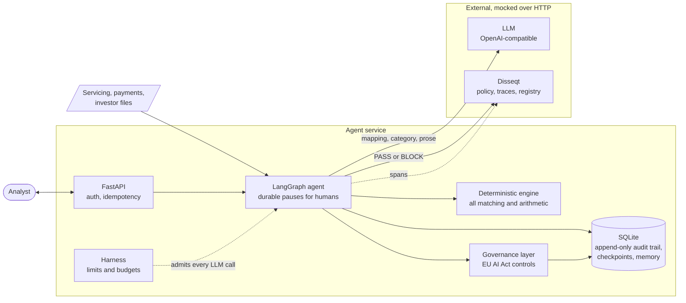
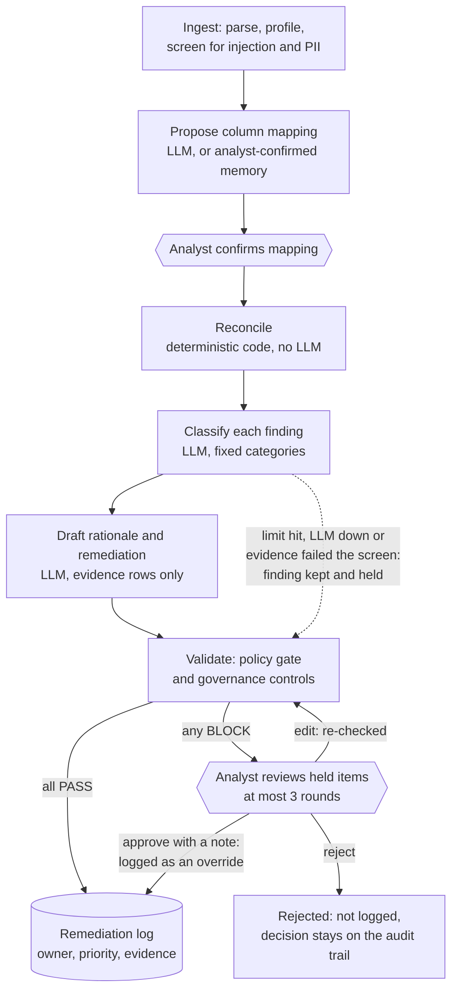

# Mortgage Capital: Reconciliation Agent with EU AI Act Controls

A proof of concept that reconciles mortgage data, explains every break in plain English, and
produces the audit evidence a regulator would ask for. It is the take-home for the Disseqt FDE
exercise, and runs entirely on synthetic data and mock endpoints.

Each period, three files should agree and often don't:

| File | What it says |
|---|---|
| **Servicing extract** | What each loan should have paid, and its balance and rates |
| **Payments file** | What cash actually arrived |
| **Investor report** | What was reported to the funders |

The agent finds the disagreements, such as missing payments, duplicate direct debits and rate
versus margin breaches. Each one comes with its evidence rows, a drafted explanation, an owner, a
priority and a remediation note. Anything that fails validation is held for a human.

> **Real versus mocked.** The reconciliation engine, agent, limits, audit trail and governance
> logic are real code. The LLM and Disseqt are mocks reached over real HTTP, and the data is
> synthetic. No real model or Disseqt endpoint has been called.

## Quick start

Requires Python 3.11+.

```bash
python -m venv .venv && source .venv/bin/activate
pip install -e ".[dev]"

pytest          # unit, flow and API tests; no network, no LLM
mc-recon eval   # scorecard of 16 normal and hostile scenarios
mc-recon serve  # the agent API on :8000
```

With the server running, walk through one reconciliation:

```bash
H=(-H X-Analyst-Id:alice -H content-type:application/json)

# Start a run. It pauses for a human before anything is reconciled.
RID=$(curl -s -X POST localhost:8000/runs "${H[@]}" -d '{"dataset":"pair_01"}' | jq -r .run_id)

# Review the proposed column mapping, then confirm it.
curl -s localhost:8000/runs/$RID/mapping | jq '.proposal.mapping.payments, .problems'
curl -s -X POST localhost:8000/runs/$RID/mapping/confirm "${H[@]}" -d '{}' | jq .status

# See what it found, what it cost, and the compliance position.
curl -s localhost:8000/runs/$RID/remediation-log | jq '.[] | {loan_id, category, owner, priority, rationale}'
curl -s localhost:8000/runs/$RID/harness | jq .usage
curl -s 'localhost:8000/governance/report?format=markdown'
```

## Design

### Architecture



Every external dependency sits behind an interface (`LLMProvider`, `PolicyGate`, span exporters),
so a recorded fake, the HTTP mock and a real service are interchangeable through configuration.

### How a run flows



The dotted line is the design's key safety property. By the time the LLM is involved, the engine
has already found the discrepancy, so losing the LLM costs automation and never a finding.

### Principles

1. **The LLM never touches a number.** Matching, netting and comparison are `Decimal` arithmetic
   in tested code. The LLM only proposes a mapping, picks from a closed category list, and writes
   prose from the evidence it is given.
2. **Humans hold the decisions that matter.** Nothing reconciles until an analyst confirms the
   mapping, and a failed validation can only be released by a person, who must record why.
3. **Fail closed, fail loud.** A policy outage or unparseable verdict becomes BLOCK. Malformed
   input stops the run with a specific error instead of producing a plausible result.
4. **Every loop has a number on it.** The worst case of a run can be read from one config object.
5. **Evidence is written at run time.** The audit trail is append-only, enforced by database
   triggers, and the compliance report is a query over it.

## Features

### Use Case 1: reconciliation and anomaly detection

| Capability | Detail |
|---|---|
| File intake | Handles non-canonical headers and mixed date and number formats; rejects anything ambiguous |
| Human mapping checkpoint | LLM proposes, analyst confirms or edits, and the mapping is validated against the real headers |
| Deterministic engine | Seven discrepancy types (below); identical inputs give byte-identical output |
| Constrained classification | Category limited per finding type; anything else becomes `OTHER_NEEDS_REVIEW` |
| Grounded explanations | Rationale and remediation note from the finding's evidence rows only |
| Validation before release | Faithfulness, context and answer relevance, data leakage, tool-call accuracy, plan coherence |
| Input safety | Prompt-injection and PII screens on samples, whole files, and each finding before any prompt |
| Review workflow | `approve`, `edit` (re-validated) or `reject`, recorded with the analyst's identity |
| Remediation log | Owner, priority P1 to P3, SLA, amount at risk, evidence and final verdict |
| Baseline and analytics | Simulated manual process through the same checks; latency, tokens, cost, scores and drift |

### Use Case 2: risk, policy and regulatory compliance

| Control | Requirement | Evidenced by |
|---|---|---|
| `TECH-RAG-GROUNDING-CITE` | Art 15, Accuracy & Robustness | Faithfulness and context-relevance scores against a threshold |
| `TECH-HUMAN-LOOP` | Art 14, Human Oversight | Mapping confirmation and review events, with analyst identity |
| `TECH-LOG-PIPELINE` | Art 12, Record-Keeping | Completeness of model, inputs, rule version, approver and evidence |

A breach holds the output for review and is recorded either way. Each evaluation writes evidence
with a 24-hour freshness window, so a control counts as met only while its evidence is current.
Stale or missing evidence appears as a coverage gap in `GET /governance/report`. The layer is
separate from the agent and `MC_GOVERNANCE=off` disables it.

### Agent harness

| Area | What's bounded or managed |
|---|---|
| Loops | Review rounds (3; the last refuses `edit`), schema re-asks (1), graph recursion backstop |
| Spend, per run | LLM calls (500), tokens (500k), cost ($5), LLM time (600s) |
| Failure | Circuit breaker after 3 consecutive LLM failures; bounded retries with backoff on HTTP calls |
| Input | File size and row limits; a flood of findings stops the run as a likely wrong mapping |
| Prompts | One finding per call, no accumulating context; oversized prompts refused, never truncated |
| Checkpoints | Pruned to the latest after each segment, with the audit trail untouched |
| Long-term memory | Only analyst-confirmed mappings, with expiry and re-validation; an analyst still confirms |

Defaults are overridable with `MC_LIMIT_<NAME>`, and `GET /runs/{id}/harness` shows a run's usage
against them. [docs/HARNESS.md](docs/HARNESS.md) has the full table and what happens at each limit.

### Mock endpoints and evaluation

`mc-recon mock` serves Disseqt (registry, policies, validate, traces, ledger, dashboard) and an
OpenAI-compatible LLM, with injectable failures. `mc-recon eval` then proves the behaviour end to
end. It covers accuracy against the seeded errors, every limit, outages, injection in a late file
row, restart after checkpoint pruning, memory, the full HTTP path and the governance lifecycle.

To run the agent against the mock instead of the in-process fakes:

```bash
mc-recon mock &
MC_LLM_PROVIDER=http MC_LLM_BASE_URL=http://localhost:8100 MC_LLM_API_KEY=mock-key \
MC_POLICY_GATE=http MC_DISSEQT_URL=http://localhost:8100 MC_DISSEQT_API_KEY=mock-key \
mc-recon serve
```

### Operations

- Hardened container: non-root, read-only root filesystem, hash-pinned dependencies, health probes.
- Kubernetes manifest and per-cloud notes in [docs/DEPLOYMENT.md](docs/DEPLOYMENT.md).
- CI on every push: lint, tests, evaluation, image build and a smoke test of the running container.
- Crash recovery: a paused run resumes from its checkpoint after a process restart.
- Idempotent writes through `Idempotency-Key`, safe under concurrent retries.

## Reconciliation rules

| Discrepancy | Rule | Default tolerance |
|---|---|---|
| `UNMATCHED_EXPECTED_PAYMENT` | No payment within the window around the due date | ±3 days |
| `DUPLICATE_PAYMENT` | Repeat direct debits with the same mandate and amount; later ones excluded from netting | 5 days |
| `AMOUNT_MISMATCH` | Net received differs from scheduled; split payments that net correctly are fine | 0.01 |
| `RATE_COMPONENT_MISMATCH` | Applied rate differs from base plus margin, or investor figures differ from servicing | 0.005 pp |
| `BALANCE_MISMATCH` | Investor closing balance differs from servicing | 0.05 |
| `UNMATCHED_PAYMENT` | Payment for an unknown loan, or outside the match window | n/a |
| `POPULATION_MISMATCH` | Loan is in only one of servicing and investor data | n/a |

## API

| Endpoint | Purpose |
|---|---|
| `POST /runs` | Start a run; it pauses for mapping confirmation |
| `GET /runs/{id}` | Status, pending human action, exception counts, manifest |
| `GET /runs/{id}/mapping` | Proposed mapping, problems, column profiles, screening results |
| `POST /runs/{id}/mapping/confirm` | Accept (`{}`) or supply an edited `mapping` |
| `GET /runs/{id}/exceptions` | Exceptions with category, rationale, verdicts and reviews |
| `POST /runs/{id}/exceptions/{exc}/review` | `approve` (needs `note`), `edit` or `reject` |
| `GET /runs/{id}/remediation-log` | Final log with evidence and verdict |
| `GET /runs/{id}/events` | Audit trail of oversight, policy and limit events |
| `GET /runs/{id}/trajectory` | Ordered steps the agent took |
| `GET /runs/{id}/metrics`, `GET /metrics` | Latency, tokens, cost, scores and drift, per run or overall |
| `GET /runs/{id}/harness` | Usage against limits, limits reached, held findings |
| `POST /baselines`, `GET /baselines/latest` | Run or read the manual-process baseline |
| `GET`, `DELETE /memory/mappings` | Inspect remembered mappings; delete by `/{fingerprint}` |
| `GET /governance/system`, `/controls`, `/coverage`, `/evidence`, `/report` | UC2 registry record, status, coverage, evidence and report |
| `GET /healthz`, `/readyz` | Liveness and readiness |

Interactive docs are at `/docs` (Swagger UI) and `/redoc` while the server runs. The spec is also
committed at [docs/openapi.json](docs/openapi.json), generated from the code with `mc-recon
openapi`, and a test fails if it goes stale. Tests also send real requests in every run state and
fail on any response field the contract doesn't declare.

Mutating calls accept `Idempotency-Key`, and every error has the body `{"error", "detail"}`. Set
`MC_ANALYST_TOKENS=token:analyst,...` to require a token on every route except the probes,
including the docs. To open `/docs` in a browser, enter any username and the token as the
password. Without tokens the service runs in local mode, trusts the `X-Analyst-Id` header, leaves
reads and docs open, and warns at startup. All settings are environment variables, documented in
[`src/mc_recon/config.py`](src/mc_recon/config.py).

## Repository layout

```
src/mc_recon/
  engine/          Deterministic core: schema, loader, profiling, reconciliation rules
  llm/             Provider interface, prompts, strict output schemas, fake and HTTP providers
  data/            Synthetic data generator and ground-truth LLM recordings
  mocks/           Mock Disseqt and LLM server with fault injection
  graph.py         The LangGraph agent: nodes, routing, human pauses
  service.py       Run lifecycle; validates human actions before resuming the graph
  api.py           FastAPI app and service wiring
  api_models.py    Response contracts that generate the OpenAPI spec
  limits.py        AgentLimits and RunBudget
  memory.py        Checkpoint pruning and mapping-memory guards
  policy.py        PolicyGate interface, fake validators, fail-closed wrappers
  governance.py    UC2 controls, evidence, coverage and report
  remediation.py   Deterministic owner, priority, SLA and amount at risk
  baseline.py      Manual-process baseline
  metrics.py       Per-run and cross-run analytics
  observability.py Tracing and span exporters
  store.py         SQLite store with append-only tables
  transport.py     Bounded retries for external HTTP
  disseqt_http.py  Disseqt policy, trace and registry clients
  evaluation.py    `mc-recon eval` scenarios
  config.py, server.py, cli.py
data/synthetic/    Three seeded datasets with expected results
tests/             Unit, flow, API, deployment and harness tests
docs/              Harness, deployment and API contract
deploy/kubernetes/ Portable manifest
requirements/      Hash-pinned lock files (`make lock` to refresh)
scripts/           Black-box smoke test
```

## Test data

`data/synthetic/pair_01` to `pair_03` hold 40, 60 and 80 loans with planted errors, regenerated
byte for byte by `mc-recon generate`. Each has the three input files, the correct mapping, a
catalog of every planted error, and recordings of what a perfect LLM would answer.

They also carry harmless noise that must **not** raise exceptions: odd loan-reference casing, split
payments that net correctly, ±0.01 rounding, late value dates inside the window, and weekend rolls.
The tests require zero misses and zero false positives on every dataset. A changed prompt or
payload fails loudly with a missing recording instead of replaying a stale answer.

## Known limitations

- The Disseqt API routes and payloads are assumed, because its docs are behind a login. That
  assumption is confined to `disseqt_http.py` and `mocks/app.py`. The fake validators are simple
  deterministic stand-ins for the real ones.
- Test accuracy reflects the mocked LLM replaying perfect answers. It validates the engine and the
  pipeline, not a live model's quality.
- SQLite and in-process locks limit this to one replica. Scaling out needs the Postgres backends.
- Graph calls are synchronous. A live model would need a background worker.
- Static tokens stand in for SSO. Retention is recorded but nothing purges on a schedule, and the
  `risk_level`, `provider_role` and retention values are placeholders for compliance to set.

## Further reading

| Document | Covers |
|---|---|
| [docs/HARNESS.md](docs/HARNESS.md) | Limits, memory, input screening, mocks and evaluation |
| [docs/openapi.json](docs/openapi.json) | The API contract, generated from the code |
| [docs/DEPLOYMENT.md](docs/DEPLOYMENT.md) | Container image, per-cloud notes, secrets and scaling |
