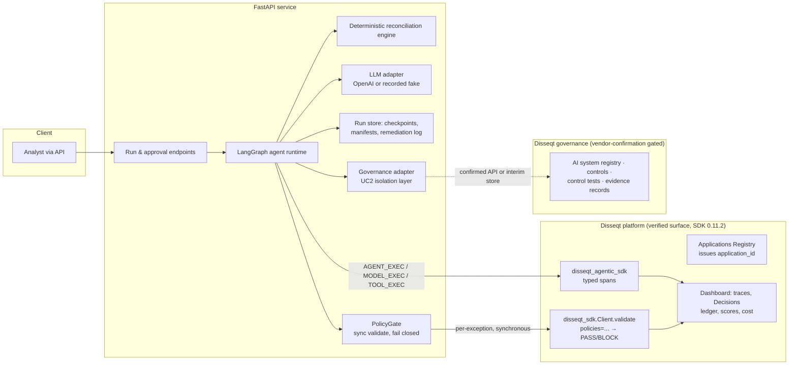
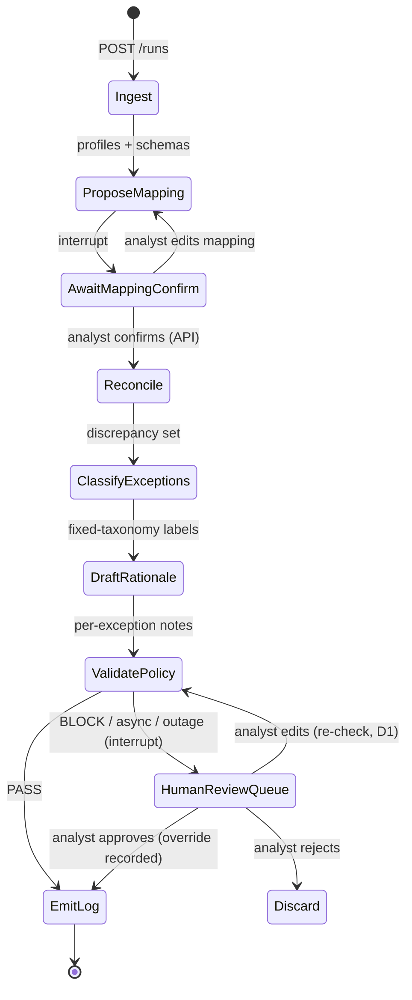

# Implementation Plan v2.1 — Mortgage Capital Unified AI PoC

**Use Case 1:** Data Reconciliation & Anomaly Detection agent (LangGraph + FastAPI)
**Use Case 2:** Risk, Policy & Regulatory Compliance layer (EU AI Act Arts. 12, 14, 15)

## Change log

**v2.1 (this version)** — the Disseqt SDK surface was checked against the source of the
pinned package, `disseqt-ai-sdk==0.11.2` (wheel contents, not the README). Corrections:

| # | v2 said | 0.11.2 actually does | Fix |
|---|---|---|---|
| C1 | `project_id` is legacy | `DisseqtAgenticClient` raises `ValueError` if `project_id` is missing | Pass `project_id` **and** keyword-only `application_id` |
| C2 | `evaluate_policy(...)`, `parse_policy()` | Neither exists. Policies run through `disseqt_sdk.Client.validate(request, policies=[...])`; helpers are `disseqt_sdk.policy.parse / is_blocking / is_async` and `disseqt_sdk.any_blocking` | `PolicyGate` wraps `validate` + `parse` |
| C3 | Binding the exception policy as the tracer's `realtime_policy_id` gates output | That only tags spans with `policy.id` so the server checks them **after the fact**. It does not block anything | The `validate_policy` node calls `validate()` synchronously. The tracer gets no policy, or a separate monitoring-only one, so exceptions aren't evaluated twice |
| C4 | Async results can be acted on | `enforcement: async` responses aren't final (`is_async`) | Exception policy must be **sync**; an async response counts as BLOCK (fail closed) |
| C5 | `ToolCallAccuracy` / `PlanCoherence` in the per-exception policy | These are agent-behaviour validators expecting `tool_calls` / `conversation_history` / `agent_responses` | Move them to a run-level, monitoring-only policy |
| C6 | `DataLeakageValidator` in the ingest screen | It's in the **MCP-security** domain | Confirm the right input-side leakage validator with Disseqt in Week 1 |
| C7 | Python ≥ 3.10 | `Requires-Python >=3.10.14` | Project targets 3.11+ |
| C8 | — | Policy evaluation needs `application_name` on `disseqt_sdk.Client` (it labels the Decisions ledger) | Set `application_name="mc-reconciliation-agent"` (same as `service_name`) |

Design addition **D1:** an exception an analyst *edits* in `human_review_queue` is re-checked
against the policy before `emit_log`. If it still BLOCKs, it is logged as a human override with
the analyst's identity. Without this, the Art. 15 evidence would have a gap.

Design addition **D2:** the deterministic engine emits structural `DiscrepancyKind`s. The
classifier picks a business `ExceptionCategory`, but only from the set allowed for that kind
(`constrain_category`). Anything else becomes `OTHER_NEEDS_REVIEW` and goes to a human.

## 1. Guiding principles

1. **Hard determinism boundary.** The LLM never touches a number. It proposes mappings,
   classifies into a fixed taxonomy and writes prose. Matching, netting and comparison run in
   deterministic, unit-tested code (`src/mc_recon/engine`).
2. **No unvalidated output reaches an analyst.** Every drafted exception is checked against the
   Disseqt realtime policy. A BLOCK sends it to human review; nothing is ever silently dropped.
3. **Audit evidence is emitted, not reconstructed.** The compliance report is a query over
   evidence written at execution time.
4. **Every non-deterministic dependency sits behind an interface.** LLM calls go through a
   provider-agnostic adapter with a deterministic fake. UC2's unverified governance surface goes
   behind a governance adapter.

## 2. Architecture overview



### Verified Disseqt integration (Use Case 1)

- **Package:** `disseqt-ai-sdk==0.11.2`. It contains `disseqt_sdk` (validation and policies),
  `disseqt_agentic_sdk` (tracing) and `disseqt_logging` (structured logging with PII/credential
  redaction). Requires Python ≥ 3.10.14.
- **Tracing client** (0.11.2 signature):

```python
from disseqt_agentic_sdk import DisseqtAgenticClient, start_trace
from disseqt_agentic_sdk.enums import SpanKind

tracer = DisseqtAgenticClient(
    api_key=settings.disseqt_api_key,
    project_id=settings.disseqt_project_id,        # still required in 0.11.2
    service_name="mc-reconciliation-agent",
    endpoint=settings.disseqt_trace_endpoint,
    application_id=settings.application_id,        # required, keyword-only → X-Application-Id
    # realtime_policy_id: omit, or a monitoring-only policy. It does NOT gate (see C3).
)
```

  `application_id` is required. The server rejects traces without a matching `X-Application-Id`,
  which is the attribution guarantee Use Case 2 depends on.

- **Policy gate** (the synchronous check that actually blocks output):

```python
from disseqt_sdk import Client
from disseqt_sdk.policy import parse, is_async
from disseqt_sdk.models.output_validation import OutputValidationRequest

validator = Client(
    project_id=settings.disseqt_project_id,
    api_key=settings.disseqt_api_key,
    application_name="mc-reconciliation-agent",   # required for policy evaluation
    timeout=10,
)
resp = validator.validate(
    OutputValidationRequest(prompt=task_prompt, context=evidence_rows_json, response=rationale),
    policies=[settings.exception_policy_id],
)
decision = parse(resp)       # PolicyDecision: decision, enforcement, policy_version, rulesets...
blocked = decision is None or is_async(resp) or decision.decision != "PASS"   # fail closed
```

  > Week 1: confirm the exact request type and the response envelope expected for a
  > policy-only call against the live endpoint. The shape above follows the 0.11.2 docstrings.

- **Span kinds:** `AGENT_EXEC` (run), `MODEL_EXEC` (LLM calls, with `set_model_info`,
  `set_messages`, `set_token_usage`), `TOOL_EXEC` (engine/parser/writer). `instrument_all(client)`
  can capture `MODEL_EXEC` spans automatically. We still set explicit attributes (prompt
  version, node name, `LLMRequest.cache_key`).
- **Realtime policies** are authored and published in the Disseqt dashboard as named, versioned
  validator bundles. Every evaluation lands on the Decisions ledger. `PolicyDecision.policy_version`
  goes into the run manifest. A threshold change is a dashboard publish with no code deploy, and
  each published version is itself audit evidence.

**Other components:** FastAPI service as the only entry point. LangGraph with a persistent
checkpointer (SQLite for the PoC) and durable interrupts for the two human checkpoints. A
pure-Python deterministic reconciliation engine. An LLM adapter with `OpenAIProvider` and
`RecordedFakeProvider`.

## 3. LangGraph graph design



| Node | Work | Kind | Disseqt emission | Status |
|---|---|---|---|---|
| `ingest` | Parse 3 files, hash, profile columns; input-safety screen | Code | `TOOL_EXEC` | profiling ✅ (`engine/profile.py`) |
| `propose_mapping` | Column correspondences, structured output | LLM | `MODEL_EXEC` | payload + schema + oracle recordings ✅ |
| `await_mapping_confirm` | Durable interrupt; approver identity recorded | Human | oversight span | Week 2 |
| `reconcile` | Match, net, compare; typed discrepancies with row evidence | Code | `TOOL_EXEC` | ✅ (`engine/reconcile.py`) |
| `classify_exceptions` | Closed-enum labels, constrained per kind | LLM | `MODEL_EXEC` | payload + schema + guard ✅ |
| `draft_rationale` | Rationale + remediation note, evidence rows only | LLM | `MODEL_EXEC` | payload + schema ✅ |
| `validate_policy` | `PolicyGate` → PASS/BLOCK, fail closed | Disseqt | Decisions-ledger entry | Week 3 |
| `human_review_queue` | Durable interrupt for BLOCKed exceptions | Human | oversight span | Week 3 |
| `emit_log` | Idempotent remediation log write keyed `(run_id, discrepancy.id)` | Code | `TOOL_EXEC` | Week 3 (ids are stable ✅) |

**"PII checks", re-specified:**
- **Ingest-time screen:** `InputPromptInjectionValidator` plus an input-side leakage check (C6)
  over file-derived text (headers, profile samples, free-text columns such as `NARRATIVE`) before
  any of it reaches an LLM prompt.
- **Output screen:** `OutputDataLeakageValidator` in the exception policy.
- **Log hygiene:** `disseqt_logging` redaction on all service logs.

**Exception policy** (dashboard-authored, sync enforcement, block):
`FaithfulnessValidator`, `ContextRelevanceValidator`, `AnswerRelevanceValidator`,
`OutputDataLeakageValidator`, with the `all` decision strategy.
**Run-level monitoring policy** (optional, tracer-bound, non-gating): `ToolCallAccuracyValidator`,
`PlanCoherenceValidator`.

## 4. FastAPI surface

- `POST /runs`, `GET /runs/{run_id}`: start or inspect runs.
- `GET /runs/{run_id}/mapping`, `POST /runs/{run_id}/mapping/confirm`: view, confirm or edit
  the proposed mapping. The authenticated analyst identity is recorded as the Art. 14 oversight
  event.
- `GET /runs/{run_id}/exceptions`: drafted exceptions with per-rule scores and verdicts, taken
  from the parsed `PolicyDecision`.
- `POST /exceptions/{id}/review`: approve, edit (triggers a re-check) or reject BLOCKed
  exceptions.
- `GET /runs/{run_id}/remediation-log`: the final log with evidence references.

All mutating endpoints are idempotent via client-supplied keys.

## 5. Reliability strategy

- Structured outputs with strict Pydantic validation (`extra="forbid"`) and one bounded re-ask.
- Enum-constrained classification, plus the per-kind guard (D2).
- Rationale context is the discrepancy's evidence rows and nothing else (`rationale_request`).
- Versioned prompts (`PROMPT_VERSIONS`) at temperature 0. `LLMRequest.cache_key` hashes
  `(task, prompt_version, payload)`.
- Timeouts and capped retries on side-effect-free LLM nodes **and** on `PolicyGate`. If Disseqt
  is unreachable, the response is async, or it can't be parsed, the result is BLOCK-equivalent
  (fail closed).
- Transactional remediation-log writes keyed `(run_id, discrepancy.id)`. Discrepancy ids are
  content-derived and stable across reruns.
- Checkpointer resume across crashes and restarts.
- Loud failure on malformed engine input (`MappingError`, `ParseError`, `EngineInputError`).
- Golden regression suite in CI on the recorded fake, plus a scheduled live-model drift run that
  compares live outputs against the oracle recordings.
- Week 1 manual-process baseline.

## 6. Audit strategy

The five-part evidence chain: run manifest (file sha256s, `ENGINE_VERSION`, prompt versions,
policy id **and** `policy_version`, model id) → typed spans → oversight events → validation
records → append-only remediation log.

- **Attribution is enforced:** spans without a valid `application_id` are rejected server-side.
- **Policy versions are server-side audit artifacts:** policies are versioned and published, and
  every evaluation lands on the Decisions ledger. The manifest records which version judged each
  output.
- **Every finding is re-derivable:** each `EvidenceRef` points to `(source, row)` in a file whose
  sha256 is in the manifest.

## 7. Use Case 2: governance layer

UC2 adds no new agent behaviour, only registration, wiring and reporting over UC1's telemetry.

**Verified foundation:** the Applications Registry (issues `application_id`), Disseqt's published
EU AI Act article mapping, compliance dashboards, and decision logs.

**Not publicly verifiable:** the control-ID scheme (`TECHRAGGROUNDINGCITE`, `TECHHUMANLOOP`,
`TECHLOGPIPELINE`), `metric_threshold` control tests evidenced by `sdk_event`, evidence records
with freshness SLAs, and a governance registry with `risk_level` / `lifecycle_stage` /
`provider_role`. That registry shape matches Brutor AI's asset-registry docs rather than anything
public from Disseqt.

1. **Week 1 gate: vendor confirmation** against the gated platform docs.
2. **Governance adapter:** all UC2 platform touchpoints go through one thin module of ours.
3. **Fallback that keeps the deliverable:** if a governance object doesn't exist as proposed, the
   adapter writes the same evidence to an interim store of ours. The Compliance, Governance and
   Assurance Report is generated from that store plus Disseqt's verified surfaces.

**Controls (unchanged):** grounding (Art. 15) evidenced by faithfulness and context-relevance
scores on every exception; human oversight (Art. 14) evidenced by mapping-confirmation and
review-decision events, including D1 overrides; record-keeping (Art. 12) evidenced by trace-store
completeness and retention.

## 8. Data plan

Start with mock data. Three seeded synthetic pairs are committed under `data/synthetic/` and
generated by `mc-recon generate`:

| Pair | Loans | Header variant | Seeded errors |
|---|---|---|---|
| `pair_01` | 40 | A | missing payment, duplicate DD, rate-vs-margin breach |
| `pair_02` | 60 | B | the three above + partial payment, investor balance break |
| `pair_03` | 80 | A | all six, including an unidentified payment |

Each pair also carries benign noise that must **not** raise exceptions: loan-ref case/whitespace,
split Faster Payments netting to the schedule, ±0.01 balance rounding, 4dp rate drift within
tolerance, a +2-day value date, and weekend rolls. `seeded_errors.json` records the expected
`DiscrepancyKind` and `ExceptionCategory` for each error. `oracle_recordings.json` holds the
ground-truth LLM responses for the recorded fake. If real anonymised samples are granted, they
slip in behind the ingest interface.

## 9. Four-week timeline

| Week | Use Case 1 | Use Case 2 |
|---|---|---|
| **1** | ✅ Deterministic engine + unit tests; ✅ synthetic data + seeded-error catalog; ✅ LLM adapter protocol + recorded fake. Remaining: register application (`application_id`); wire `DisseqtAgenticClient` and verify spans land; confirm `validate(policies=…)` request/response shape live (C2); manual-process baseline | Vendor-confirmation gate; decide confirmed-API vs. interim-store path |
| **2** | LangGraph graph with checkpointer + mapping interrupt; `OpenAIProvider`; mapping and classification nodes; FastAPI run/approval endpoints | Register the governed system or stand up the interim store; confirm `risk_level`/`provider_role`/retention |
| **3** | Rationale drafting; span instrumentation; author + publish the policies (sync); `PolicyGate`; BLOCK review queue with re-check (D1); remediation log; golden suite in CI | Wire the three controls through the adapter; verify span → evidence → control status |
| **4** | Hardening: crash-resume, idempotency, fail-closed outage test, live-model drift run; dashboard walkthrough | Evidence freshness; coverage-gap review; generate the report; demo |

## 10. Risks and open questions

- **Governance surface mismatch** (highest UC2 risk): mitigated by the Week 1 gate and the
  adapter + interim store.
- **SDK version drift:** C1–C8 show the README, PyPI metadata and the code disagree. The SDK is
  pinned at `0.11.2`. Re-verify signatures against the wheel on every upgrade.
- **Double evaluation** (C3): if the same policy is bound to both the tracer and `PolicyGate`,
  expect duplicate ledger entries. Keep them separate.
- **Sample data access:** the design starts with mock data, so real data changes fixtures, not
  architecture.
- **Validator threshold calibration:** done in Week 3 against seeded ground truth. Each published
  calibration is an audit artifact.
- **Governance metadata decisions** (`risk_level`, `provider_role` = deployer, Art. 12
  retention): Week 2 with compliance.
- **LLM account specifics:** the adapter keeps the provider swappable, and the fake keeps CI
  independent.
- **Open:** which Disseqt validator is right for input-side leakage on raw file text (C6).
